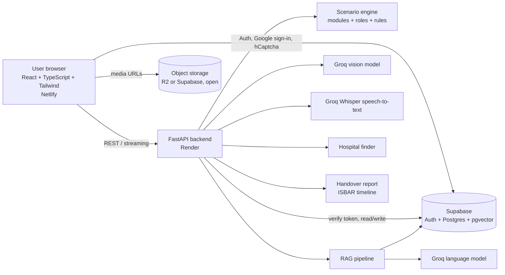

# Architecture overview

## Principles
- The browser fetches media directly from storage/CDN. Media bytes never pass through the backend.
- The step-to-media mapping is returned with the step text so the browser can start loading immediately.
- The service-role key lives only on the backend.
- The scenario engine decides the safe order of steps; the RAG system explains and answers questions around them.
- Everything about the RAG pipeline is evaluated before it is chosen.
