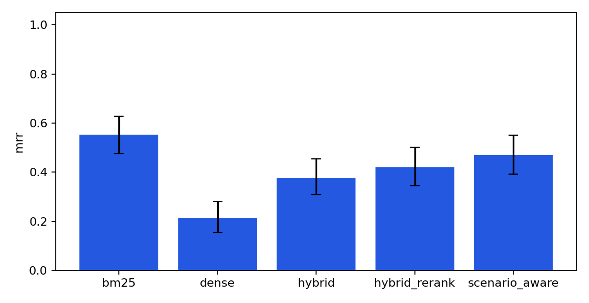

# Evaluation report

Generated by `python -m rag_eval.cli run`. Seed questions are a smoke test, not paper results.

| Variant | MRR (95% CI) | Mean latency ms |
|---|---|---|
| bm25 | 0.552 (0.476 to 0.627) | 11.2 |
| dense | 0.214 (0.155 to 0.280) | 7.7 |
| hybrid | 0.377 (0.308 to 0.454) | 22.6 |
| hybrid_rerank | 0.420 (0.345 to 0.502) | 17.5 |
| scenario_aware | 0.470 (0.392 to 0.551) | 31.0 |

